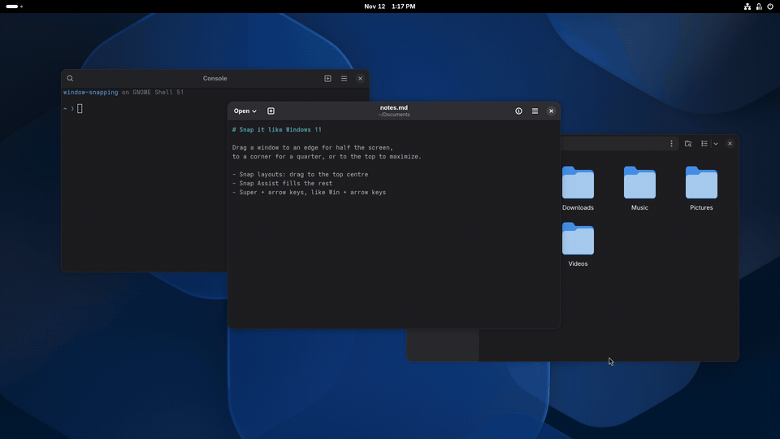
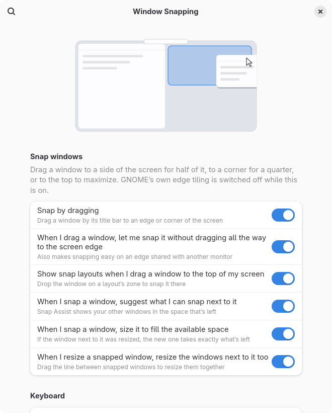

# Window Snapping

Windows 11 window snapping for GNOME: drag a window to any edge or corner, pick a snap layout, let Snap Assist fill the rest, and use the Super + arrow keys exactly like Win + arrow keys.

<p align="center">
  
</p>

- **Every edge and every corner.** Drag a window to the left or right edge for half the screen, to any of the four corners for a quarter, or to the top to maximize. A frosted preview shows where it'll go and glides along as you move.
- **Snap layouts.** Drag a window to the top of the screen and hold it there a moment: the snap bar drops down with halves, two-thirds, thirds, quarters and more. Drop the window on a zone. (Let go right away and it maximizes, as usual.) Super + Z opens the same layouts from the keyboard.
- **Snap Assist.** After you snap a window, the space that's left fills with your other windows. Pick one and it snaps in, until the screen is full.
- **Super + arrow keys that behave like Windows.** Halves, quarters, maximize, restore, minimize and moving to the next monitor, step by step, the way Win + arrow keys do it.
- **Snapped windows stay tidy.** Drag the line between snapped windows to resize them together. Drag a snapped window away and it gets its original size back.
- **Several monitors**, including snapping against the edge two screens share.

GNOME's own snapping only does left and right halves and maximize. This replaces it with the whole Windows 11 set while it's turned on, and gives it back when it's turned off. It's separate from any panel or dock, so it works the same with Dash to Panel, Dash to Dock or GNOME's own top bar.

**If this is useful to you, please ⭐ [star the repo](https://github.com/Jire/window-snapping) and [follow @Jire on GitHub](https://github.com/Jire) for more free tools like this.**

## Install

Paste the command for your distro into a terminal. Don't use `sudo`: it installs into your home folder.

**Arch Linux, EndeavourOS, CachyOS, Manjaro**

```bash
curl -fsSL https://raw.githubusercontent.com/Jire/window-snapping/main/install.sh | bash
```

**Fedora**

```bash
curl -fsSL https://raw.githubusercontent.com/Jire/window-snapping/main/install.sh | bash
```

**Ubuntu and Ubuntu-based** (uses `wget`, which Ubuntu ships with by default)

```bash
wget -qO- https://raw.githubusercontent.com/Jire/window-snapping/main/install.sh | bash
```

Ubuntu comes with its own tiling extension (Tiling Assistant) turned on, and it handles the same drags and keys. The installer turns it off and tells you so; uninstalling Window Snapping with the same script turns it back on. The same goes for Tiling Shell, Pop Shell, Forge, WinTile and gTile if you have them on. To keep them, add `-s -- --keep-conflicts` after `bash`.

Then **log out and back in**. GNOME only loads newly installed extensions at login (or see the next section to load it right away).

### Load without logging out (Wayland)

GNOME's built-in Looking Glass console can load the extension into the running session:

1. Press <kbd>Alt</kbd>+<kbd>F2</kbd>, type `lg`, press <kbd>Enter</kbd>.
2. Paste this line into the prompt at the bottom and press <kbd>Enter</kbd>:

   ```js
   eval(new TextDecoder().decode(imports.gi.GLib.file_get_contents(imports.gi.GLib.get_user_data_dir() + '/window-snapping/hot-load.js')[1]))
   ```

3. Press <kbd>Esc</kbd>. A notification confirms it loaded.

This also works for reloading after an update. At your next normal login the regular installed copy loads as usual.

## How to use

**With the mouse**, drag a window by its title bar:

| Drag to | You get |
| --- | --- |
| The left or right edge | That half of the screen |
| A corner | That quarter of the screen |
| The top edge, including the centre | Maximized |
| The top centre, then hold still for a moment | The snap bar drops down: hover a zone of any layout, drop the window there |
| Away from where it's snapped or maximized | Its original size back, right under the pointer |
| Anywhere, then press <kbd>Esc</kbd> | Cancelled: it goes back where it was |

The line between two snapped windows can be dragged to resize both at once. Dragging a window's top edge to the top of the screen stretches it to full height, keeping its width.

**With the keyboard**, on the focused window:

| Keys | What happens |
| --- | --- |
| <kbd>Super</kbd>+<kbd>←</kbd> / <kbd>→</kbd> | Snap to the left / right half. Again: on to the next monitor. From the other half: back to its normal size. |
| <kbd>Super</kbd>+<kbd>↑</kbd> | Maximize. On a half: the top quarter of that side. On a maximized window: the top half. |
| <kbd>Super</kbd>+<kbd>↓</kbd> | Restore a maximized window, minimize a normal one. On a half: the bottom quarter, then minimize. |
| <kbd>Super</kbd>+<kbd>Alt</kbd>+<kbd>↑</kbd> / <kbd>↓</kbd> | Snap to the top / bottom half |
| <kbd>Super</kbd>+<kbd>Z</kbd> | Snap layouts for the window: press a layout's number, then a zone's number (or use the arrows and <kbd>Enter</kbd>) |

Snap Assist opens once you let go of <kbd>Super</kbd>, so you can press the arrows several times first, like on Windows. In Snap Assist, click a window, or move with the arrow keys or <kbd>Tab</kbd> and press <kbd>Enter</kbd>. <kbd>Esc</kbd> or a click anywhere else closes it; <kbd>Delete</kbd> closes the selected window.

## Settings

Open **Extensions** and click the gear next to Window Snapping, or run:

```bash
gnome-extensions prefs window-snapping@jire.github.io
```

If you don't have the Extensions app, install it with `sudo pacman -S gnome-extensions-app` (Arch), `sudo dnf install gnome-extensions-app` (Fedora) or `sudo apt install gnome-shell-extension-prefs` (Ubuntu).

<picture>
  <source media="(prefers-color-scheme: dark)" srcset="docs/preferences-dark.png">
  
</picture>

The first five match the switches in Windows 11's Settings › System › Multitasking › Snap windows.

| Setting | Default | What it does |
| --- | --- | --- |
| Snap by dragging | On | Edges, corners and the top of the screen snap windows dragged there. |
| Snap without dragging all the way to the screen edge | On | Snapping starts a little before the edge, so it's easy on an edge shared with another monitor too. |
| Show snap layouts when I drag a window to the top of my screen | On | The snap bar. |
| When I snap a window, suggest what I can snap next to it | On | Snap Assist. |
| When I snap a window, size it to fill the available space | On | If a snapped neighbour was resized, the new window takes exactly the space that's left. |
| When I resize a snapped window, resize the windows next to it too | On | Drag the line between snapped windows to resize them together. |
| Windows-style Super + arrow keys | On | Off gives the arrows back to GNOME. |
| Super + Z opens snap layouts | On | |
| Super + Alt + ↑ / ↓ snap to the top / bottom half | On | GNOME normally uses these to step through the overview and app grid. |
| Gap between snapped windows | 0 px | Windows 11 leaves none. With no gap, snapped halves get square corners like on Windows. |
| Animations | Follow system setting | Or always / never animate snapping. |

## Update

Run the install command again.

## Uninstall

```bash
curl -fsSL https://raw.githubusercontent.com/Jire/window-snapping/main/install.sh | bash -s -- --uninstall
```

(On Ubuntu, swap the start for `wget -qO- …`.) You can also remove it from the **Extensions** app. Either way, GNOME's own edge tiling and shortcuts come back as soon as the extension is turned off.

## Requirements

- **GNOME Shell 46 to 51.** Check yours with `gnome-shell --version`. That covers Ubuntu 24.04 LTS and newer, Fedora 40 and newer, Debian 13, and current Arch and its derivatives.
  - Developed on GNOME 51 (Arch Linux, Wayland). The same automated tests pass on GNOME 46, 48, 49, 50 and 51, each run in a real (headless) GNOME Shell of that version, driving real app windows with a virtual mouse and keyboard: edges and corners, the snap bar, Snap Assist, every Super + arrow transition, several monitors, resizing snapped windows together, Esc to cancel, and turning the extension off and on again. GNOME 47 sits between 46 and 48 and uses the same code.
  - The few places where GNOME's API differs between versions are handled in one file, `extension/compat.js`.
- Any app works: GTK, Qt, Electron, browsers and XWayland apps (Steam, many games) are all moved by GNOME Shell itself.

## How it works

- **Dragging:** while you drag a window, the extension follows the pointer and works out which edge, corner or layout zone it's on. GNOME's own edge tiling is switched off while the extension runs, because it would react to the same drags; the original setting is put back when the extension is turned off (it's kept in the extension's own settings in the meantime, so even a crash can't lose it).
- **Snapping:** a snapped window is moved and resized into its zone with a short animation (a snapshot of the window glides to the new spot while the app redraws, so you never see a half-drawn frame). Snapped halves are also marked as tiled, so apps square off their corners, like Windows 11 does.
- **Restoring:** each snapped window remembers the size and position it had before it was snapped. Dragging it away, Super + ↓, or restoring it after maximizing it brings that back.
- **Keys:** Super + arrow keys stay bound to GNOME's own "View split on left/right", "Maximize" and "Restore" actions (you can still change them in GNOME Settings); only what they do changes. Super + Alt + ↑ / ↓ are set aside from GNOME's overview while the extension runs, and put back when it's turned off.
- **Snap Assist** shows live thumbnails of the windows on the current workspace, most recently used first, over a frosted view of your wallpaper. Windows already snapped on that screen aren't offered again.
- **The frosted glass** of the preview, the snap bar and Snap Assist is made from live copies of what's behind it, blurred in a buffer of its own. (GNOME's built-in background blur works from the screen as it was last drawn, which can leave stale, banded patches in the glass.)

## Troubleshooting

```bash
gnome-extensions info window-snapping@jire.github.io   # is it enabled? any errors?
journalctl --user -f -g window-snapping                 # what it's doing (turn on Debug logging in the settings first)
```

- **Nothing happens when I drag to an edge:** make sure the extension is enabled (above), and that no other tiling extension is on (the settings window warns you if one is).
- **Super + arrow keys do GNOME's usual thing:** check that "Windows-style Super + arrow keys" is on, and that the keys are still assigned to "View split on left/right", "Maximize window" and "Restore window" in GNOME Settings › Keyboard › Shortcuts.

If something still looks wrong, turn on **Debug logging**, reproduce it while watching the log, and include the output in an [issue](https://github.com/Jire/window-snapping/issues).

## Build from source

```bash
git clone https://github.com/Jire/window-snapping.git
cd window-snapping
npx --yes eslint@9 .                               # lint
gjs -m tests/geometry.test.js                      # unit tests
scripts/build.sh                                   # creates dist/<uuid>.shell-extension.zip
./install.sh --zip dist/window-snapping@jire.github.io.shell-extension.zip
```

After changing code, rebuild, reinstall with `--zip`, and run the Looking Glass line above to reload without logging out. [AGENTS.md](AGENTS.md) describes the code layout and how to test changes in a separate, headless GNOME Shell.

## Support

This is free software, made in my spare time. The best ways to support it:

- ⭐ [Star the repo](https://github.com/Jire/window-snapping), which helps other people find it.
- 👤 [Follow @Jire on GitHub](https://github.com/Jire) to hear about more free tools like this.
- 🐛 [Report bugs or request features](https://github.com/Jire/window-snapping/issues).

## License

[GPL-2.0-or-later](LICENSE), the same license as GNOME Shell.
